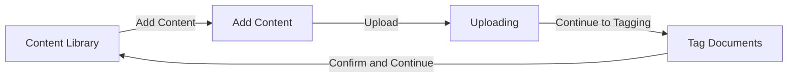
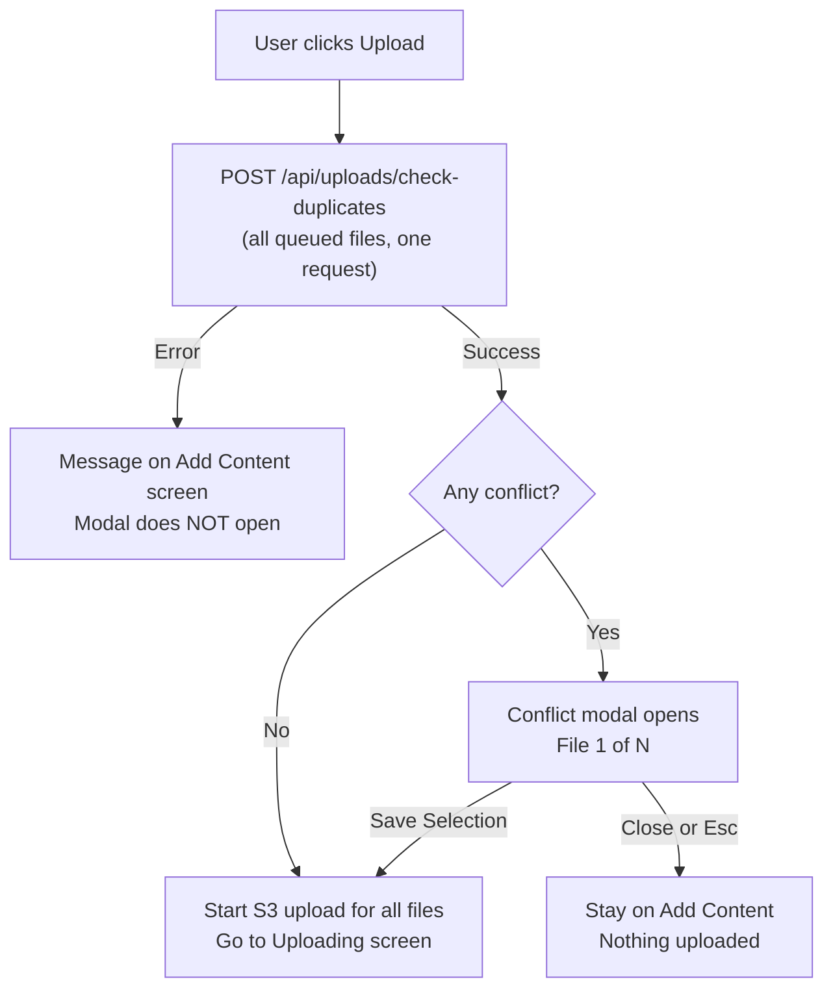
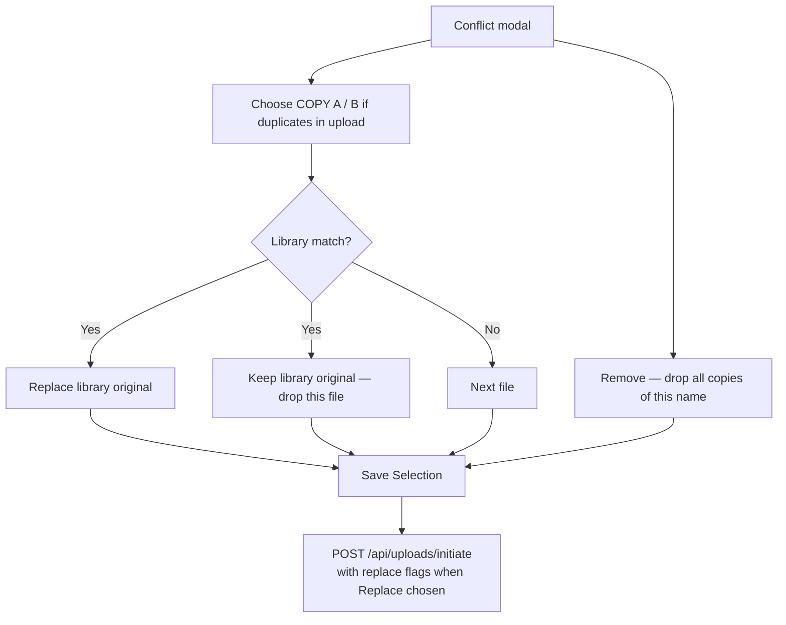
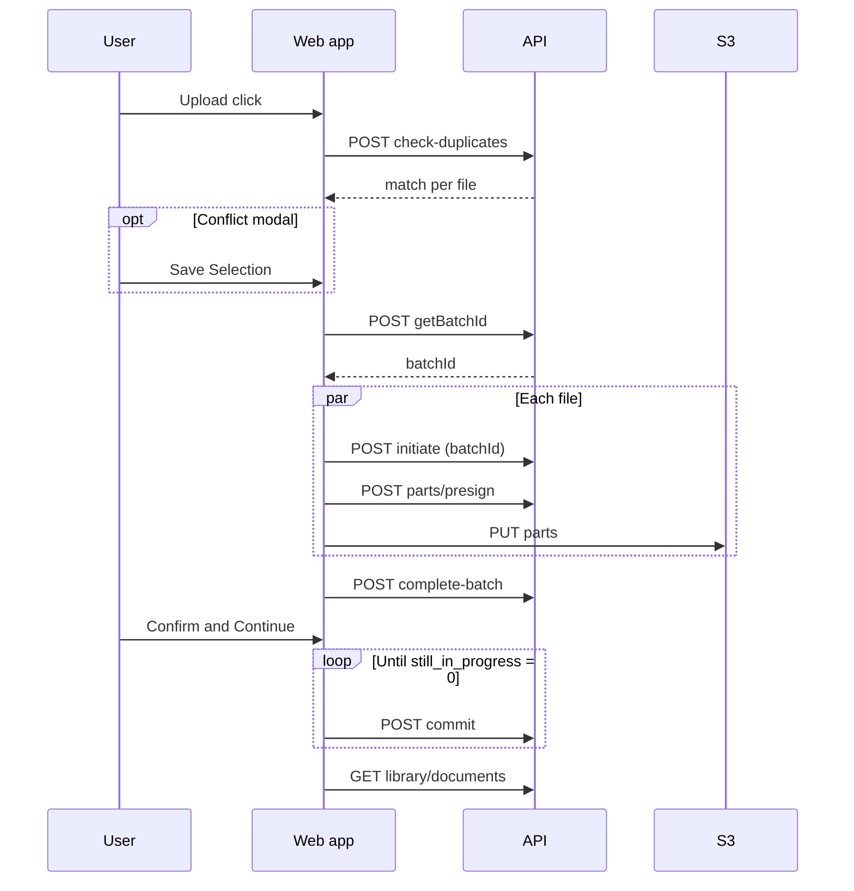

# Content Library — Upload flow (UI + API)

| | |
|---|---|
| **For** | Confluence — product, QA, integration |
| **Page in app** | `/dashboard/content-library` |
| **API base (local)** | `http://localhost:8000` |
| **Last updated** | 2026-09-30 |

> **Diagrams:** Mermaid blocks render on GitHub and in Confluence with a Mermaid macro. Export PNG from [mermaid.live](https://mermaid.live) if needed.

---

## Table of contents

1. [Screens the user walks through](#1-screens-the-user-walks-through)
2. [What happens when you click Upload](#2-what-happens-when-you-click-upload)
3. [Conflict modal (Replace / Keep / Remove)](#3-conflict-modal-replace--keep--remove)
4. [API calls in order (one Upload click)](#4-api-calls-in-order-one-upload-click)
5. [API reference — request and response](#5-api-reference--request-and-response)
6. [Direct-to-S3 upload (not through the API)](#6-direct-to-s3-upload-not-through-the-api)
7. [After upload — Tag step and library](#7-after-upload--tag-step-and-library)
8. [Error format](#8-error-format)
9. [Rules before any API call (drop files)](#9-rules-before-any-api-call-drop-files)

---

## 1. Screens the user walks through



| Screen | What the user does |
|--------|-------------------|
| **Content Library** | See existing documents, download, open **Add Content** |
| **Add Content** | Drop or browse files, review the list, click **Upload** |
| **Uploading Documents** | Watch per-file progress; **Retry** if a file fails; **Continue to Tagging** when done |
| **Tag Documents** | Choose specialty and document type (shown in UI; not sent to server yet), **Confirm & Continue** |

**Batch:** After duplicate check (and the conflict modal if needed), the app calls **`POST /api/uploads/getBatchId`** and gets a **`batchId`**. Every **`initiate`** in that Upload click sends the same `batchId`; **`commit`** uses it in the URL.

**File bytes:** The API never receives the file content. Only JSON metadata and presigned URLs. Parts go **browser → S3** (LocalStack locally).

---

## 2. What happens when you click Upload



**Conflicts that open the modal**

| Situation | How it is detected |
|-----------|-------------------|
| Same file name twice in this upload | Client groups duplicates (name, case-insensitive) |
| File already in library | Server returns a `match` on check-duplicates |
| Both | One wizard step: pick copy **and** Replace or Keep |

**While the modal is open:** No call to `initiate`, presign, or S3. Upload starts only after **Save Selection** (or immediately if there were no conflicts).

---

## 3. Conflict modal (Replace / Keep / Remove)



| User choice | What gets uploaded |
|-------------|-------------------|
| **Replace library original** | Selected file uploads with `replace: true` and `replacesDocumentId` from the library match |
| **Keep library original** | That file is removed from the queue; library unchanged |
| **Remove** | All copies of that file name removed from the upload |
| **Close (×) or Esc** | Modal closes; queue unchanged; nothing sent to S3 |

Replace warning in UI: replacing archives the previous library version (cannot be undone from this screen).

---

## 4. API calls in order (one Upload click)

| Step | When | Endpoint |
|-----:|------|----------|
| 0 | Open Content Library | `GET /api/v1/library/documents` |
| — | Drop files | *(no API — local checks only)* |
| 1 | Click **Upload** | `POST /api/uploads/check-duplicates` |
| — | Save Selection (if modal) | *(then steps 2–6)* |
| 2 | After duplicate check passes (and modal if any) | `POST /api/uploads/getBatchId` → get `batchId` |
| 3 | Per file, in parallel | `POST /api/uploads/initiate` (include `batchId`; response includes `parts` URLs) |
| 4 | Per file, optional | `POST /api/uploads/parts/presign` (retry / extra parts only — not used on first upload in the web app) |
| 5 | Per part | `PUT` to URL from `initiate.parts` or presign → **S3** (see §6) |
| 6 | When every file has all parts | `POST /api/uploads/complete-batch` |
| 7 | **Confirm & Continue** on Tag screen | `POST /api/v1/uploads/batches/{batchId}/commit` (repeat every ~2 s while `still_in_progress > 0`, up to ~120 s) |
| 8 | Back on library | `GET /api/v1/library/documents` |
| 9 | User clicks Download | `GET /api/v1/library/documents/{documentId}/download` |

Optional (not used for happy path in current UI): `GET /api/uploads/{uploadId}/parts?key=…` to list parts already in S3 for resume after interruption.

On cancel/remove during upload: `POST /api/uploads/abort` with `key` + `uploadId` (best effort).



---

## 5. API reference — request and response

Paths under **`/api/uploads/*`** use **camelCase** in JSON. Paths under **`/api/v1/*`** use **snake_case** in responses.

---

### 5.1 `POST /api/uploads/getBatchId`

**When:** After **check-duplicates** succeeds and any conflict modal is saved — **before** any `initiate`.

**Request:** no body.

**Response `200`**

```json
{ "batchId": "bbb64607-855f-46c1-ab7a-a2f45a5a3278" }
```

Pass this **`batchId`** on every **`initiate`** for that Upload click, and use the same id in **`commit`**.

**Errors:** `503` organization not configured · body `{"detail": "…"}`

---

### 5.2 `POST /api/uploads/check-duplicates`

**When:** Once per **Upload** click, before S3.

**Request**

```json
{
  "files": [
    { "filename": "Whipple Procedure.docx", "fileSize": 3355443 },
    { "filename": "Knee Surgery Recovery.pdf", "fileSize": 43008 },
    {
      "filename": "Cardiology Pack.zip",
      "fileSize": 18874368,
      "entries": [
        { "filename": "Heart Failure Discharge.pdf", "fileSize": 1288490 },
        { "filename": "forms/Famotidine.pdf", "fileSize": 102400 },
        { "filename": "Echo Report.pdf", "fileSize": 15360 }
      ]
    }
  ]
}
```

| Field | Meaning |
|-------|---------|
| `filename` | As dropped |
| `fileSize` | Size in bytes, must be &gt; 0 |
| `entries` | Optional on **`.zip`** files: each inner file to check (`filename` = path or basename, `fileSize` = uncompressed bytes). Omitted on non-ZIP files. The UI sends every listed ZIP member after local ZIP validation. |

**Response `200` — no library conflict**

```json
{ "files": [] }
```

**Response `200` — one or more library conflicts** (only clashing files are listed; match by `filename` + `fileSize`, or for ZIP entries by entry `filename` + `fileSize` using the entry basename against the library)

```json
{
  "files": [
    {
      "filename": "Whipple Procedure.docx",
      "fileSize": 3355443,
      "duplicate": true,
      "match": {
        "documentId": "2eb73800-75ac-584f-b5fb-7916363d3df0",
        "title": "Whipple Procedure",
        "fileName": "Whipple Procedure.docx",
        "sizeBytes": 3355443,
        "addedAt": "2026-09-28T14:30:31.943184Z",
        "currentVersion": 1,
        "kind": "same_name_size"
      }
    },
    {
      "filename": "Cardiology Pack.zip",
      "fileSize": 18874368,
      "duplicate": true,
      "entries": [
        {
          "filename": "Echo Report.pdf",
          "fileSize": 15360,
          "duplicate": true,
          "match": {
            "documentId": "7a1d3c52-9e0b-5c1e-8f6a-2d4b8c9e0f13",
            "title": "Echo Report",
            "fileName": "Echo Report.pdf",
            "sizeBytes": 15360,
            "addedAt": "2026-09-28T14:30:31.943184Z",
            "currentVersion": 1,
            "kind": "same_name_size"
          }
        }
      ]
    }
  ]
}
```

For ZIPs, `match` on the outer file may be omitted when only inner entries clash; only conflicting `entries` are listed.

| `match.kind` | Meaning |
|--------------|---------|
| `same_name_size` | Library has same file name (case-insensitive) and exact size |
| `same_title` | Library has same title (name without extension); size may differ |

**Errors:** `422` invalid body · `503` organization not configured · body `{"detail": "…"}`

---

### 5.3 `POST /api/uploads/initiate`

**When:** Once per file that will upload (after modal, if any).

**Request — new document**

```json
{
  "filename": "Knee Surgery Recovery.pdf",
  "fileSize": 43008,
  "contentType": "application/pdf",
  "batchId": "bbb64607-855f-46c1-ab7a-a2f45a5a3278"
}
```

**Request — replace library document (after modal: Replace library original)**

```json
{
  "filename": "Whipple Procedure.docx",
  "fileSize": 3355443,
  "contentType": "application/vnd.openxmlformats-officedocument.wordprocessingml.document",
  "batchId": "bbb64607-855f-46c1-ab7a-a2f45a5a3278",
  "replace": true,
  "replacesDocumentId": "2eb73800-75ac-584f-b5fb-7916363d3df0"
}
```

| Field | Rule |
|-------|------|
| `replace` | Must be `true` exactly when `replacesDocumentId` is sent |
| `replacesDocumentId` | Library document id from check-duplicates `match.documentId` |
| `batchId` | Same UUID for every file in one Upload click |

**Response `200`**

```json
{
  "fileId": "f2bf1cdb-0674-47d5-9c4e-e3121f0e2286",
  "uploadId": "Zm9vYmFyLXVwbG9hZC1pZA",
  "partSize": 8388608,
  "totalParts": 1,
  "parts": {
    "1": "http://localhost:4566/clinsync-poc/ClinSync/incoming/…?partNumber=1&uploadId=…&X-Amz-Signature=…"
  }
}
```

| Field | Meaning |
|-------|---------|
| `parts` | Presigned **PUT** URL per part number (`"1"`, `"2"`, …). Use these directly for S3 upload; the web app does **not** call presign on the first attempt. |

`batchId` is **not** returned here — use the value from **`getBatchId`** (same id you sent on this request).

**Common errors (`{"detail": "…"}`):** `400` unsupported type · `409` duplicate / batch closed · `413` file too large · `404` replace target not found

---

### 5.4 `POST /api/uploads/parts/presign`

**When:** Optional — fresh URLs for a subset of parts (e.g. **Retry** after failure or expired signatures). Normal upload uses **`parts` on initiate** instead.

**Request**

```json
{
  "fileId": "f2bf1cdb-0674-47d5-9c4e-e3121f0e2286",
  "uploadId": "Zm9vYmFyLXVwbG9hZC1pZA",
  "partNumbers": [1, 2, 3]
}
```

**Response `200`**

```json
{
  "urls": {
    "1": "http://localhost:4566/clinsync-poc/…?X-Amz-Signature=…",
    "2": "http://localhost:4566/clinsync-poc/…?X-Amz-Signature=…",
    "3": "http://localhost:4566/clinsync-poc/…?X-Amz-Signature=…"
  }
}
```

**Errors:** `404` Upload not found · `409` Upload is not awaiting completion · `400` empty partNumbers

---

### 5.5 `GET /api/uploads/{uploadId}/parts?fileId={fileId}`

**When:** Resume — list parts S3 already has. **Implemented on server; current web UI does not call this** (in-session Retry uses parts already stored in the browser).

**Response `200`**

```json
{
  "parts": [
    {
      "partNumber": 1,
      "etag": "\"9b2cf535f27731c974343645a3985328\"",
      "size": 8388608
    }
  ]
}
```

**Errors:** `404` Upload not found or `S3 error (NoSuchUpload): …` · `409` Upload is not awaiting completion

---

### 5.6 `POST /api/uploads/complete-batch`

**When:** Once per Upload click, after all files have finished uploading parts (or failed). One file failing does not block others.

**Request**

```json
{
  "files": [
    {
      "fileId": "f2bf1cdb-0674-47d5-9c4e-e3121f0e2286",
      "uploadId": "Zm9vYmFyLXVwbG9hZC1pZA",
      "parts": [
        { "partNumber": 1, "etag": "\"9b2cf535f27731c974343645a3985328\"" }
      ]
    },
    {
      "fileId": "e57d740b-0674-47d5-9c4e-e3121f0e2286",
      "uploadId": "YmF6LXVwbG9hZA",
      "parts": [
        { "partNumber": 1, "etag": "\"1f3a77c8e4d2a1b0c9e8f7d6a5b4c3d2\"" }
      ]
    }
  ]
}
```

**Response `200`**

```json
{
  "files": [
    {
      "fileId": "f2bf1cdb-0674-47d5-9c4e-e3121f0e2286",
      "uploadId": "Zm9vYmFyLXVwbG9hZC1pZA",
      "ok": true,
      "key": "ClinSync/incoming/…_Whipple Procedure.docx",
      "id": "f2bf1cdb-0674-47d5-9c4e-e3121f0e2286",
      "location": "s3://clinsync-poc/ClinSync/incoming/…",
      "status": "uploaded",
      "batchId": "bbb64607-855f-46c1-ab7a-a2f45a5a3278",
      "errorStatus": null,
      "error": null
    },
    {
      "fileId": "e57d740b-0674-47d5-9c4e-e3121f0e2286",
      "uploadId": "YmF6LXVwbG9hZA",
      "ok": false,
      "id": null,
      "location": null,
      "status": null,
      "batchId": null,
      "errorStatus": 400,
      "error": "Upload session expired — start the upload again"
    }
  ],
  "completed": 1,
  "failed": 1
}
```

After `ok: true` and `status: "uploaded"`, the server enqueues background processing (type check, ZIP extract, hash). The Uploading screen shows success when **S3 + complete-batch** succeed, not when processing finishes.

---

### 5.7 `POST /api/uploads/abort`

**When:** User removes a file or clears queue while upload is in progress.

**Request**

```json
{
  "fileId": "f2bf1cdb-0674-47d5-9c4e-e3121f0e2286",
  "uploadId": "Zm9vYmFyLXVwbG9hZC1pZA"
}
```

**Response `200`**

```json
{ "ok": true }
```

---

### 5.8 `POST /api/v1/uploads/batches/{batchId}/commit`

**When:** User clicks **Confirm & Continue** on Tag Documents. Repeated while `still_in_progress` &gt; 0.

**Request:** no body.

**Response `200`**

```json
{
  "added": 2,
  "documents": [
    "7a1d3c52-9e0b-5c1e-8f6a-2d4b8c9e0f13",
    "c4e8a1b2-3d5f-5a7c-9b1e-6f2d8a4c0e57"
  ],
  "replaced": [
    {
      "document_id": "2eb73800-75ac-584f-b5fb-7916363d3df0",
      "version": 2,
      "previous_version": 1
    }
  ],
  "skipped": [
    {
      "staged_id": "0b6e2f1a-4c3d-5e6f-7a8b-9c0d1e2f3a4b",
      "file_name": "Cardiac Rehab Protocol.docx",
      "reason": "A document with this title is already in the library"
    }
  ],
  "still_in_progress": 0
}
```

| Field | Meaning |
|-------|---------|
| `added` / `documents` | New library documents created |
| `replaced` | Documents updated to a new version (Replace path) |
| `skipped` | Candidates not added, with reason |
| `still_in_progress` | Files still being processed — call commit again later |

Specialty and document type from the Tag screen are **not** sent in this POC.

**Errors:** `{"error": {"code": "not_found", "message": "…"}}` etc.

---

### 5.9 `GET /api/v1/library/documents`

**When:** Page load and after successful commit.

**Response `200`**

```json
{
  "documents": [
    {
      "document_id": "2eb73800-75ac-584f-b5fb-7916363d3df0",
      "title": "Whipple Procedure",
      "file_name": "Whipple Procedure.docx",
      "file_ext": "docx",
      "size_bytes": 3355443,
      "created_at": "2026-09-28T14:30:31.943184Z"
    }
  ],
  "total": 1
}
```

---

### 5.10 `GET /api/v1/library/documents/{documentId}/download`

**When:** User downloads a row from the library table.

**Response `200`**

```json
{
  "url": "http://localhost:4566/clinsync-poc/ClinSync/processed/…?X-Amz-…",
  "expires_at": "2026-09-30T05:15:00Z"
}
```

Browser navigates to `url`; file downloads with the current file name.

---

## 6. Direct-to-S3 upload (not through the API)

| Item | Value |
|------|--------|
| Method | `PUT` to each URL from `parts/presign` |
| Body | Raw bytes for that part (typically 8 MiB chunks) |
| Headers | Do **not** send `Content-Type` on the PUT |
| Response | `200` with **ETag** header (bucket CORS must expose `ETag`) |
| Concurrency | Up to 4 parts at a time per file |
| Retries | Per part, with backoff; fresh presign if needed |

Collect each part’s `partNumber` and `etag` for `complete-batch`.

---

## 7. After upload — Tag step and library

| Phase | User sees | Server |
|-------|-----------|--------|
| Uploading | Progress %, then “uploaded” per file | Worker may still be checking ZIP / hashing |
| Tag Documents | Tag fields (UI only today) | — |
| Confirm | Success message with added / replaced / skipped counts | `commit` adds ready documents |
| Content Library | Updated table | `GET library/documents` |

The app may call **commit** several times (about every 2 seconds) until `still_in_progress` is 0, because processing can finish after S3 upload completes.

---

## 8. Error format

| API prefix | Error shape | Example |
|------------|-------------|---------|
| `/api/uploads/*` | `{"detail": "Upload not found."}` | Duplicate messages often contain the word **Duplicate** |
| `/api/uploads/*` validation | `422` with `{"detail": [ … ]}` | Invalid JSON body |
| `/api/v1/*` | `{"error": {"code": "not_found", "message": "…"}}` | Commit, library |

---

## 9. Rules before any API call (drop files)

Checked in the browser when files are added (server checks again on `initiate`):

| Rule | Value |
|------|--------|
| Allowed file types | `.docx`, `.pdf`, `.zip` |
| Allowed inside ZIP | `.docx`, `.pdf` (bad entries = warning, not block, unless zip has no usable entry) |
| Max file size | 5 GiB |
| Empty file | Rejected |
| Same name twice in one drop | Allowed in list; resolved in conflict modal on Upload |

---

*Full server-side rules and edge cases: [`lld-file-upload-content-library.md`](lld-file-upload-content-library.md)*
