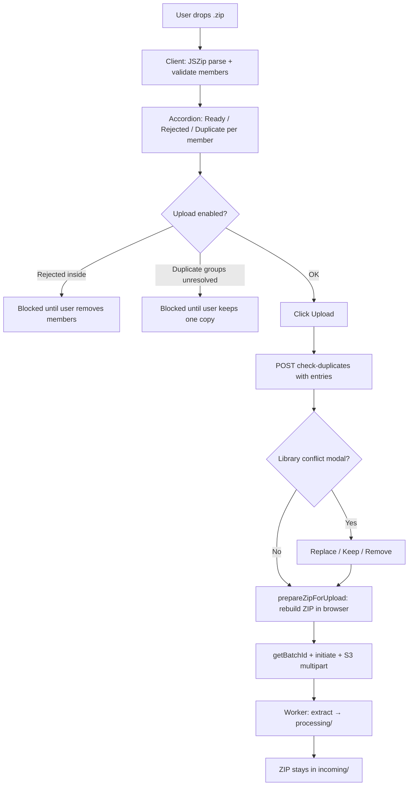

# ZIP upload — LLD (Confluence)

| | |
|---|---|
| **For** | Confluence — product, QA, backend, frontend |
| **Page in app** | `/dashboard/content-library` → Add Content |
| **Related** | [confluence-frontend-upload.md](./confluence-frontend-upload.md), [lld-file-upload-content-library.md](./lld-file-upload-content-library.md) |
| **Last updated** | 2026-10-09 |

Short reference for **when ZIP upload is enabled**, how **members and duplicates** are handled in the UI, what is sent to the API/S3, and where objects land after ingest.

---

## 1. When ZIP upload is enabled

| Layer | Rule |
|--------|------|
| **Server** | `ALLOWED_TOP_LEVEL_EXT` includes `zip` (`GET /api/uploads/config`) |
| **Client** | File picker accepts `.zip`; dropzone validates like other top-level types |
| **UI** | Each `.zip` is shown as a **closed accordion** (not a flat row). Expand to see inner files |
| **Size** | Max **500 MiB** compressed (`MAX_ZIP_FILE_BYTES` in `zipUpload.ts`) |

Allowed **inside** the ZIP (server config): **`pdf`**, **`docx`** only. Nested `.zip` entries → **Rejected**. Paths deeper than **one subfolder** → **Rejected** (same rules as the ingest worker).

---

## 2. End-to-end flow (ZIP)



**Important:** Parsing and rebuilding the ZIP happen **only in the browser** (JSZip). The API receives **one multipart upload** of a **new, smaller ZIP** containing only **Ready** members—not the original 12-file archive if the user removed rejects/duplicates.

---

## 3. Accordion and member statuses

| Status | Meaning | Upload |
|--------|---------|--------|
| **Ready** | Allowed type, valid, not duplicate | Included in rebuilt ZIP |
| **Rejected** | Wrong type, nested zip, too deep, invalid content, etc. | Excluded; user must **remove** row or fix file |
| **Duplicate** | Same basename as another Ready copy in this session | Excluded until user resolves **duplicate group** |

**ZIP header pill** reflects the worst inner state (e.g. Rejected if any rejected member remains).

**Upload button** is disabled when:

- Any visible member is **Rejected** or **Duplicate**, or
- No **Ready** members remain, or
- Top **duplicate groups** panel has unresolved groups (same basename across standalone + ZIP members).

---

## 4. Duplicates (everything in one place)

### 4.1 Within the same ZIP

Two entries with the same **basename** (case-insensitive), e.g. `docs/a.pdf` and `backup/a.pdf` → second marked **Duplicate** (`annotateZipQueueItems`).

### 4.2 ZIP member vs standalone file in the same queue

If a standalone `report.pdf` and a ZIP member `folder/report.pdf` are both Ready → both marked **Duplicate**; resolved via **duplicate groups** (keep one, remove others).

### 4.3 Duplicate groups panel (top of Add Content)

- Built by `buildUploadDuplicateGroups`: groups all copies sharing a basename.
- Badges: **From this upload** (standalone) / **From {zipName}** (ZIP member).
- **Keep one** removes the other copies (standalone → remove queue item; ZIP member → `removeZipEntry`).

### 4.4 Same name already in the content library

On **Upload**, `POST /api/uploads/check-duplicates` runs **before** S3.

| Payload | Purpose |
|---------|---------|
| Top-level `filename` + `fileSize` | The ZIP file as a whole |
| `entries[]` | Each **uploadable** inner member (`filename` = path in zip, `fileSize`) |

If the server finds a library match → **Conflict modal** (Replace / Keep / Remove), same as non-ZIP files. No S3 upload until conflicts are saved or there were none.

### 4.5 Order of checks

1. Client validation + duplicate annotation (groups panel).
2. Server check-duplicates (+ modal if library match).
3. Rebuild ZIP → S3.

---

## 5. What goes to S3 (keys)

Bucket (POC): configurable via `S3_BUCKET` (e.g. `clynsync-file-upload-poc-2026`).

| Stage | Key pattern | Notes |
|-------|-------------|--------|
| **Incoming** (upload) | `clynsync/incoming/{batchId}/{fileId}_{filename}.zip` | Whole rebuilt ZIP |
| **Incoming** (single `.docx`/`.pdf`) | `clynsync/incoming/{batchId}/{fileId}_{filename}` | Removed after ingest |
| **Processing** (after worker) | `clynsync/processing/{batchId}/{filename}` | One object per accepted member or single file |

**ZIP behaviour (POC):** After successful extract, **the ZIP object remains in `incoming/`** so operators can see archive + extracted files. **Single files** are deleted from `incoming/` after copy to `processing/`.

If two ZIP members share the same basename in one batch, the worker may store the second as `name (1).ext` under `processing/`.

---

## 6. Developer checks

| Check | How |
|-------|-----|
| **Files packed for upload** | Browser console (dev only): `[ZIP upload] {name} → N file(s) to backend` with `files: [...]` |
| **S3 incoming (ZIP)** | Console or CLI: prefix `clynsync/incoming/{batchId}/` |
| **S3 processing** | Prefix `clynsync/processing/{batchId}/` |
| **batchId** | Network → `getBatchId` response |

Example (AWS CLI in Docker):

```bash
docker run --rm --env-file .env amazon/aws-cli s3 ls s3://YOUR-BUCKET/clynsync/incoming/ --recursive --region ap-south-1
docker run --rm --env-file .env amazon/aws-cli s3 ls s3://YOUR-BUCKET/clynsync/processing/ --recursive --region ap-south-1
```

---

## 7. Code map (quick)

| Topic | Location |
|-------|----------|
| ZIP UI accordion | `frontend/src/pages/content-library/components/ZipUploadAccordion.tsx` |
| Ready / rebuild / remove member | `frontend/src/utils/zipUpload.ts` |
| Duplicate groups | `frontend/src/pages/content-library/uploadDuplicateGroups.ts` |
| Upload orchestration | `frontend/src/pages/content-library/ContentLibraryPage.tsx` |
| Member validation | `frontend/src/utils/contentValidation.ts` |
| S3 key layout | `backend/shared/s3_paths.py` |
| Extract + processing keys | `backend/workers/tasks.py` |

---

## 8. QA checklist (ZIP + duplicates)

- [ ] ZIP > 500 MiB → rejected at drop/validation.
- [ ] Nested `.zip` inside ZIP → inner row **Rejected**; Upload disabled until removed.
- [ ] `.txt` inside ZIP → **Rejected**; not sent in `entries` or rebuilt ZIP.
- [ ] Two same basenames in one ZIP → **Duplicate**; Upload disabled until one removed or group resolved.
- [ ] Standalone + ZIP member same basename → duplicate group; Upload disabled until **Keep one**.
- [ ] After clean upload: `incoming/{batchId}/*_{zipname}.zip` present; `processing/{batchId}/` has one object per accepted PDF/DOCX.
- [ ] Console `[ZIP upload]` list matches processing filenames (modulo `(1)` suffix if collision).
